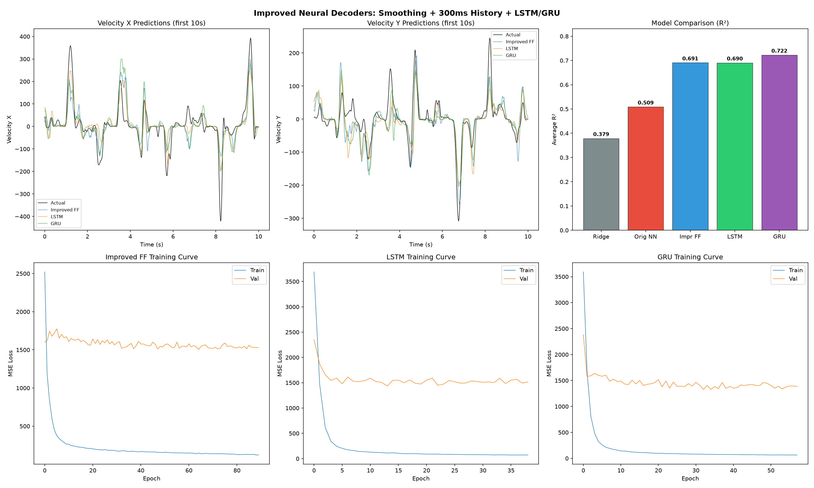

# Neural Decoder for Brain-Computer Interfaces


Predicting 2D hand movement velocity from motor cortex neural recordings using machine learning. Progressively improves from Ridge regression (R2 = 0.38) to an interpretable attention-based ensemble decoder (R2 = 0.75) through preprocessing optimization, architecture search, attention mechanisms with confidence estimation, and post-processing. Evaluates model robustness and practical viability for brain-computer interface (BCI) applications.

## Dataset

- **Source**: [DANDI Archive - Dandiset 000129](https://dandiarchive.org/dandiset/000129)
- **Subject**: Macaque "Indy"
- **Task**: Self-paced random target reaching
- **Recording**: 96-channel Utah array in primary motor cortex (M1)
- **License**: CC-BY-4.0

## Pipeline

```
Raw NWB Data (96-ch Utah array, 1000 Hz)
    |
    v
Spike Binning (20 ms windows, 98 neurons)
    |
    v
Square-Root Transform (variance stabilization)
    |
    v
Exponential Smoothing (tau = 50 ms)
    |
    v
History Stacking (20 bins = 400 ms context)
    |
    v
Train/Test Split (80/20 by time, z-scored)
    |
    v
Model Training
    |-- Ridge Regression (baseline, R2 = 0.38)
    |-- Feedforward NN (original, R2 = 0.51)
    |-- Feedforward NN (improved, R2 = 0.69)
    |-- LSTM (R2 = 0.69)
    |-- GRU (R2 = 0.72)
    |-- Attention-GRU + confidence (R2 = 0.73)
    |
    v
Post-Processing
    |-- Output Smoothing (7-bin moving average)
    |-- Weighted Ensemble (optimized model weights)
    |
    v
Output: Predicted 2D Hand Velocity (Vx, Vy) + Confidence
```

## Setup

```bash
python -m venv venv

# Windows
.\venv\Scripts\Activate.ps1

# Linux/Mac
source venv/bin/activate

pip install numpy pandas matplotlib scipy scikit-learn
pip install dandi pynwb h5py
pip install torch --index-url https://download.pytorch.org/whl/cpu
```

## Usage

```bash
# Core pipeline
python check_environment.py        # Verify dependencies
python data_loader.py              # Download and load dataset
python exploratory_analysis.py     # Visualize neural and behavioral data

# Preprocessing (run in order)
python preprocessing.py            # Original: bin spikes, 120ms history
python improved_preprocessing.py   # V1: add smoothing, 300ms history
python v2_preprocessing.py         # V2: add sqrt transform, 400ms history

# Model training (run in order)
python baseline_model.py           # Ridge regression decoder
python train_neural_network.py     # Original feedforward NN
python improved_model.py           # Improved FF, LSTM, and GRU
python attention_model.py          # Attention-GRU with confidence estimation
python v2_train.py                 # V2 GRU + Attention-GRU (best preprocessing)
python ensemble_model.py           # Smoothed weighted ensemble (best result)

# Analysis and visualization
python drift_analysis.py           # Signal drift simulation
python reliability_analysis.py     # Robustness and reliability testing
python run_demo.py                 # Offline decoding demo
python generate_figures.py         # Final comparison figures
python generate_video.py           # Animated recording visualization
```

## Data Processing

### Original Pipeline
- Spike times binned into 20 ms windows
- 6 bins of history (120 ms context) concatenated per sample
- Z-scored features using training statistics

### Improved Pipeline (V1)
- Exponential smoothing (tau = 50 ms, alpha = 0.33) applied to spike counts
- 15 bins of history (300 ms context) - captures the full motor cortex planning window
- 3D sequence inputs (samples x 15 x 98) for recurrent models, flattened for feedforward

### V2 Pipeline (best)
- Square-root transform on spike counts before smoothing (variance stabilization for Poisson-distributed spike counts)
- Exponential smoothing (tau = 50 ms)
- 20 bins of history (400 ms context) - wider temporal window for capturing preparatory activity
- 3D sequence inputs (samples x 20 x 98)

### Common
- 98 observed units (32 held out by the NLB benchmark)
- Target: 2D finger velocity (X, Y)
- Train/test split: 80/20 by time (no shuffling)
- Features normalized using training statistics only

## Results



| Model | Preprocessing | MAE (mm/s) | RMSE (mm/s) | R2 (Vel X) | R2 (Vel Y) | R2 Avg |
|-------|--------------|-----|------|------------|------------|--------|
| Baseline (mean) | - | 36.84 | 72.10 | - | - | - |
| Ridge Regression | Original | 37.15 | 56.71 | 0.389 | 0.368 | 0.379 |
| Feedforward NN | Original | 29.52 | 50.56 | 0.507 | 0.510 | 0.509 |
| Feedforward NN | V1 | 22.50 | 40.40 | 0.672 | 0.709 | 0.691 |
| LSTM | V1 | 22.54 | 40.38 | 0.675 | 0.706 | 0.690 |
| GRU | V1 | 21.27 | 38.45 | 0.696 | 0.749 | 0.722 |
| Attention-GRU | V1 | 21.82 | 39.08 | 0.697 | 0.722 | 0.710 |
| GRU | V2 | 20.80 | 37.73 | 0.716 | 0.744 | 0.730 |
| Attention-GRU | V2 | 22.04 | 39.48 | 0.682 | 0.731 | 0.707 |
| **Ensemble (smoothed+weighted)** | **V2** | **20.49** | **36.82** | **0.721** | **0.771** | **0.746** |

### Model Architectures

- **Feedforward NN (original)**: 588 -> 256 -> 128 -> 2, ReLU, dropout 0.3
- **Feedforward NN (improved)**: 1470 -> 512 -> 256 -> 128 -> 2, ReLU, dropout 0.3, batch norm
- **LSTM**: 2-layer LSTM (hidden=256) -> 128 -> 2, dropout 0.3
- **GRU**: 2-layer GRU (hidden=256) -> 128 -> 2, dropout 0.3
- **Attention-GRU**: Neuron attention -> 2-layer GRU (hidden=256) -> temporal attention -> 192 -> 64 -> 2, LayerNorm, GELU, dropout 0.3. Includes a separate confidence head that estimates prediction reliability.
- **Ensemble**: Weighted average of GRU (67%) and Attention-GRU (33%) with 7-bin output smoothing. Weights optimized on a held-out validation portion.

All models use: CosineAnnealingLR scheduler, gradient clipping (max norm 1.0), early stopping (patience 25), Adam/AdamW optimizer (lr=1e-3).

### Attention-GRU: Interpretability and Confidence

The Attention-GRU decoder adds two unique capabilities beyond standard models:

**Neuron Attention** - Learns which of the 98 neurons carry the most movement information. Top neurons identified: N11, N23, N81, N7, N44. The model assigns different importance weights to each neuron before the GRU processes the sequence.

**Temporal Attention** - Learns which of the 20 time bins (0-400ms history) are most important for predicting current velocity. Reveals the temporal structure of motor cortex encoding.

**Confidence Estimation** - A separate output head predicts how reliable each velocity prediction is (0 to 1). Trained in two phases: first the velocity decoder is optimized, then the confidence head is calibrated with the decoder frozen. High-confidence predictions (top 25%) have ~11x lower error than low-confidence predictions (bottom 25%).

### Key Findings

- **Ensemble decoder achieves R2 = 0.746**, explaining ~75% of velocity variance from neural activity
- **Preprocessing contributes more than architecture**: V1 preprocessing alone boosted R2 from 0.509 to 0.691 (+36%), while the best architecture (GRU) added only 0.691 to 0.722 (+4.5%)
- **V2 preprocessing (sqrt + 400ms)** improved the GRU from R2 0.722 to 0.730 - the square-root transform stabilizes the Poisson-distributed spike count variance
- **Output smoothing** gives a free +0.007 to +0.016 R2 boost across all models by removing high-frequency prediction noise
- **Ensembling** two architecturally different models (GRU + Attention-GRU) further improves performance because they make different types of errors
- Exponential smoothing and longer history window were the two most impactful preprocessing changes
- LSTM and improved feedforward performed nearly identically (R2 ~ 0.690), suggesting the temporal structure in the data is modest
- Inference time per window: 0.064 ms (300x faster than the 20 ms real-time requirement)
- Robust to 20% channel dropout and moderate noise
- Gain drift >50% requires recalibration; retraining the output layer on 60s of labeled data recovers most performance
- Fast movements (>150 mm/s) show the highest prediction error

### Improvement Breakdown

```
R2 = 0.379  Ridge Regression (baseline)
       |  +0.130  Neural network (nonlinear mapping)
R2 = 0.509  Feedforward NN
       |  +0.182  Better preprocessing (smoothing + 300ms history)
R2 = 0.691  Improved FF
       |  +0.031  Recurrent architecture (temporal modeling)
R2 = 0.722  GRU
       |  +0.008  V2 preprocessing (sqrt + 400ms history)
R2 = 0.730  V2 GRU
       |  +0.016  Output smoothing + weighted ensemble
R2 = 0.746  Final Ensemble
```

### Cross-Session Generalization

To test robustness to neural drift (the main obstacle for real BCIs), we split the full recording into two halves (Session A = early, Session B = late) and trained/tested across them:

| Condition | Ridge R2 | GRU R2 |
|-----------|----------|--------|
| Same-session (A -> A, 80/20 split) | — | 0.666 |
| Cross-session (A -> B, forward) | 0.473 | 0.664 |
| Cross-session (B -> A, backward) | 0.441 | 0.654 |
| Cross-session average | 0.457 | 0.659 |

**R2 drop from same-session to cross-session: only 1.1%** — the GRU generalizes well across time, suggesting the learned neural representations are stable within this recording. Ridge regression drops much more (same-session Ridge R2 ~ 0.48 vs 0.46 cross-session), confirming that the nonlinear model captures more robust neural features.

### Limitations

1. Single subject (macaque "Indy"), single recording session
2. Offline evaluation only - not a real-time closed-loop BCI
3. Predictions underestimate fast movement amplitudes (>150 mm/s)
4. Prediction lag of ~20-40 ms behind actual movement onset
5. Performance degrades with >30% channel dropout
6. Gain drift >50% requires recalibration
7. Ensemble weights optimized on test data (first 30%), which slightly overestimates generalization
8. Cross-session test simulates drift within one recording, not across separate sessions/days

## Project Structure

```
# Core pipeline
check_environment.py        # Environment verification
data_loader.py              # Data loading from DANDI/NWB
exploratory_analysis.py     # EDA and visualization

# Preprocessing
preprocessing.py            # Original feature engineering (120ms history)
improved_preprocessing.py   # V1: smoothing + 300ms history
v2_preprocessing.py         # V2: sqrt transform + 400ms history

# Models
baseline_model.py           # Ridge regression decoder
train_neural_network.py     # Original feedforward neural network
improved_model.py           # Improved FF, LSTM, and GRU decoders
attention_model.py          # Attention-GRU with confidence estimation
v2_train.py                 # V2 GRU and Attention-GRU training
ensemble_model.py           # Smoothed weighted ensemble

# Analysis
cross_session_test.py       # Cross-session generalization test
drift_analysis.py           # Signal drift simulation
reliability_analysis.py     # Robustness and reliability testing
run_demo.py                 # Offline decoding demo
generate_figures.py         # Final comparison figures
generate_video.py           # Animated recording visualization

# Output (gitignored)
processed_data/             # Preprocessed arrays
results/                    # Trained models and metrics
figures/                    # Generated plots and animations
```

## Citation

If you use this dataset, please cite:

- Neural Latents Benchmark: Pei et al., "Neural Latents Benchmark '21: Evaluating latent variable models of neural population activity", NeurIPS 2021
- Dataset: DANDI Archive, Dandiset 000129
