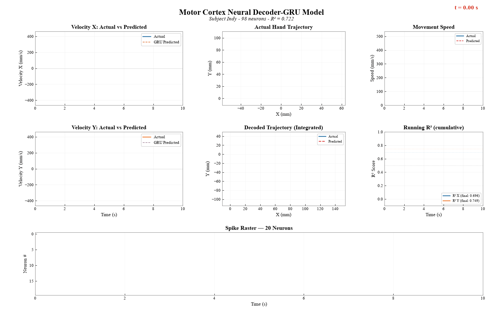

# Neural Decoder for Brain-Computer Interfaces

Predicting 2D hand movement velocity from motor cortex neural recordings using machine learning. Compares feedforward, LSTM, and GRU architectures with improved preprocessing, achieving R2 = 0.72 with the GRU decoder. Evaluates model robustness and practical viability for brain-computer interface (BCI) applications.

## Dataset

- **Source**: [DANDI Archive - Dandiset 000129](https://dandiarchive.org/dandiset/000129)
- **Subject**: Macaque "Indy"
- **Task**: Self-paced random target reaching
- **Recording**: 96-channel Utah array in primary motor cortex (M1)
- **License**: CC-BY-4.0

## Pipeline

```
Raw NWB Data (96-ch Utah array, 1000 Hz)
    |
    v
Spike Binning (20 ms windows, 98 neurons)
    |
    v
Exponential Smoothing (tau = 50 ms)
    |
    v
History Stacking (15 bins = 300 ms context)
    |
    v
Train/Test Split (80/20 by time, z-scored)
    |
    v
Model Training
    |-- Ridge Regression (baseline, R2 = 0.38)
    |-- Feedforward NN (original, R2 = 0.51)
    |-- Feedforward NN (improved, R2 = 0.69)
    |-- LSTM (R2 = 0.69)
    |-- GRU (best, R2 = 0.72)
    |
    v
Output: Predicted 2D Hand Velocity (Vx, Vy)
```

## Setup

```bash
python -m venv venv

# Windows
.\venv\Scripts\Activate.ps1

# Linux/Mac
source venv/bin/activate

pip install numpy pandas matplotlib scipy scikit-learn
pip install dandi pynwb h5py
pip install torch --index-url https://download.pytorch.org/whl/cpu
```

## Usage

```bash
python check_environment.py        # Verify dependencies
python data_loader.py              # Download and load dataset
python exploratory_analysis.py     # Visualize neural and behavioral data
python preprocessing.py            # Bin spikes, extract features, train/test split
python baseline_model.py           # Train Ridge regression decoder
python train_neural_network.py     # Train neural network decoder
python improved_preprocessing.py   # Enhanced preprocessing (smoothing + 300ms history)
python improved_model.py           # Train improved FF, LSTM, and GRU decoders
python drift_analysis.py           # Simulate signal drift and recalibration
python reliability_analysis.py     # Robustness and reliability testing
python run_demo.py                 # Run offline decoding demo
python generate_figures.py         # Generate final comparison figures
python generate_video.py           # Generate animated recording visualization
```

## Data Processing

### Original Pipeline
- Spike times binned into 20 ms windows
- 6 bins of history (120 ms context) concatenated per sample
- Z-scored features using training statistics

### Improved Pipeline
- Exponential smoothing (tau = 50 ms, alpha = 0.33) applied to spike counts before binning
- 15 bins of history (300 ms context) - captures the full motor cortex planning window
- 3D sequence inputs (samples x 15 x 98) for recurrent models, flattened for feedforward

### Common
- 98 observed units (32 held out by the NLB benchmark)
- Target: 2D finger velocity (X, Y)
- Train/test split: 80/20 by time (no shuffling)
- Features normalized using training statistics only

## Results

| Model | Preprocessing | MAE (mm/s) | RMSE (mm/s) | R2 (Vel X) | R2 (Vel Y) | R2 Avg |
|-------|--------------|-----|------|------------|------------|--------|
| Baseline (mean) | - | 36.84 | 72.10 | - | - | - |
| Ridge Regression | Original | 37.15 | 56.71 | 0.389 | 0.368 | 0.379 |
| Feedforward NN | Original | 29.52 | 50.56 | 0.507 | 0.510 | 0.509 |
| Feedforward NN | Improved | 22.50 | 40.40 | 0.672 | 0.709 | 0.691 |
| LSTM | Improved | 22.54 | 40.38 | 0.675 | 0.706 | 0.690 |
| **GRU** | **Improved** | **21.27** | **38.45** | **0.696** | **0.749** | **0.722** |

### Model Architectures

- **Feedforward NN (original)**: 588 -> 256 -> 128 -> 2, ReLU, dropout 0.3
- **Feedforward NN (improved)**: 1470 -> 512 -> 256 -> 128 -> 2, ReLU, dropout 0.3, batch norm
- **LSTM**: 2-layer LSTM (hidden=256) -> 128 -> 2, dropout 0.3
- **GRU**: 2-layer GRU (hidden=256) -> 128 -> 2, dropout 0.3

All improved models use: CosineAnnealingLR scheduler, gradient clipping (max norm 1.0), early stopping (patience 25), Adam optimizer (lr=1e-3).

### Key Findings

- **GRU decoder achieves R2 = 0.722**, explaining ~72% of velocity variance from neural activity
- **Preprocessing contributes more than architecture**: improved preprocessing alone boosted R2 from 0.509 to 0.691 (+36%), while the GRU architecture added 0.691 to 0.722 (+4.5%)
- Exponential smoothing and longer history window (300 ms vs 120 ms) were the two most impactful changes
- LSTM and improved feedforward performed nearly identically (R2 ~ 0.690), suggesting the temporal structure in the data is modest
- Inference time per window: 0.064 ms (300x faster than the 20 ms real-time requirement)
- Robust to 20% channel dropout and moderate noise
- Gain drift >50% requires recalibration; retraining the output layer on 60s of labeled data recovers most performance
- Fast movements (>150 mm/s) show the highest prediction error

### Limitations

1. Trained and tested on a single session from one subject
2. Offline evaluation only - not a real-time closed-loop BCI
3. Predictions underestimate fast movement amplitudes
4. Prediction lag of ~20-40 ms behind actual movement onset
5. Performance degrades with >30% channel dropout
6. Assumes stationary neural tuning within the session

## Project Structure

```
check_environment.py        # Environment verification
data_loader.py              # Data loading from DANDI/NWB
exploratory_analysis.py     # EDA and visualization
preprocessing.py            # Feature engineering pipeline (original)
improved_preprocessing.py   # Enhanced pipeline (smoothing + 300ms history)
baseline_model.py           # Ridge regression decoder
train_neural_network.py     # Original feedforward neural network
improved_model.py           # Improved FF, LSTM, and GRU decoders
drift_analysis.py           # Signal drift simulation
reliability_analysis.py     # Robustness and reliability testing
run_demo.py                 # Offline decoding demo
generate_figures.py         # Final comparison figures
generate_video.py           # Animated recording visualization
processed_data/             # Preprocessed arrays
results/                    # Trained models and metrics
figures/                    # Generated plots and animations
```

## Citation

If you use this dataset, please cite:

- Neural Latents Benchmark: Pei et al., "Neural Latents Benchmark '21: Evaluating latent variable models of neural population activity", NeurIPS 2021
- Dataset: DANDI Archive, Dandiset 000129
